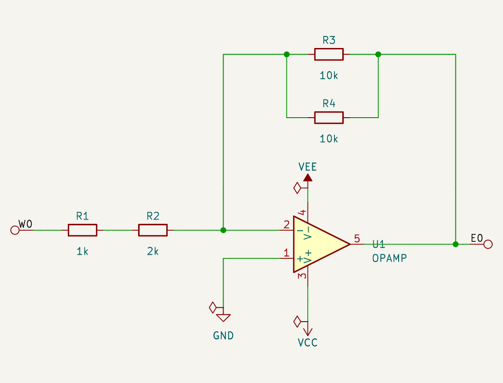
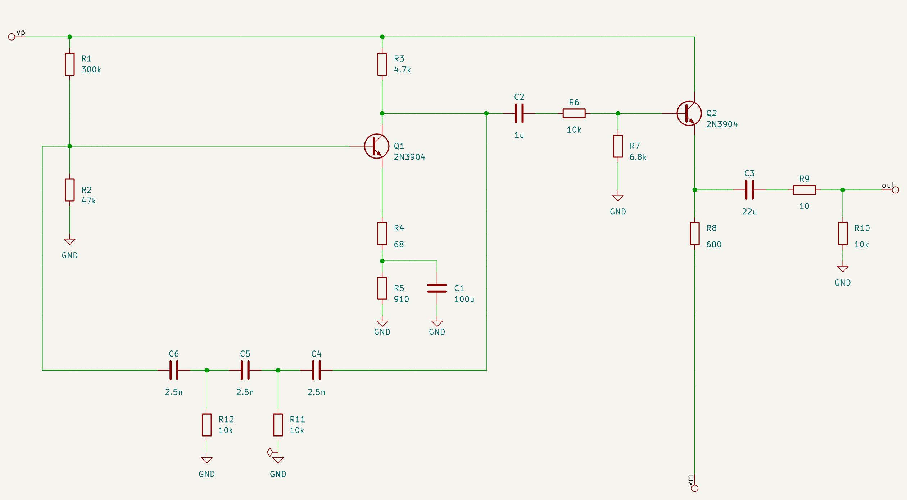

# yasdl — yet another schematic definition language

yasdl describes a circuit as an **ASCII drawing of rectangular blocks**. The drawing is both
the netlist and the layout: yasdl turns it into a readable KiCad 9 schematic by stretching
wires (never symbols) to keep everything aligned, the way Java's GridBagLayout stretches cells.

```python
from yasdl import Block, OPAMP, GND, R

SERIES = Block("Series", """
    ──R1──R2──
""", R1=R("1k"), R2=R("2k"))

PARALLEL = Block("Parallel", """
    ──┬──R1──┬──
      │      │
      └──R2──┘
""", R1=R("10k"), R2=R("10k"))

INV_AMP = Block("InvAmp", """
          ┌──────FB───────┐
          │               │
          │    <VEE>      │
          │      │        │
    ──IN──┴──────U1U1U1   │
                 U1U1U1───┴──
          ┌─────+U1U1U1
          │      │
         GND   <VCC>
""", U1=OPAMP(), GND=GND())

amp = INV_AMP.bind(IN=SERIES, FB=PARALLEL)   # sub-circuits bound into components
```



It targets machine-generated circuits (benchmark and synthesis tasks) that a person has to
check by eye. SKiDL and other netlist-first tools leave the drawing to an automatic placer;
yasdl inverts that.

---

## 1. Concepts

- **Block**: a rectangular canvas of characters. Its `W x H` cells are the text columns and
  rows. A block is a component that other blocks can use.
- **Component**: a rectangle of the canvas holding a name (`U1U1U1`, `NPN`, `FB`). Every
  component is **unbound** until a block binding gives it a value.
- **Binding**: `Block(name, canvas, U1=OPAMP(), ...)` or `.bind(...)`. A component can be
  bound to
  - an **atom**: a KiCad library symbol, rigid, can be rotated or mirrored;
  - another **block**: a sub-circuit, stretchable.
- **Unbound components** are the block's open interface (the "holes"). They are bound later
  with `block.bind(...)`. A block can only be rendered or netlisted when everything is bound.
- **Ports**: the wires that leave the canvas edge are the block's external pins.

## 2. Canvas syntax

### 2.1 Characters

| Class | Characters | Notes |
|---|---|---|
| empty | space, `.` | `.` is a visual aiming aid only |
| component | `A-Z a-z 0-9 _` | see 2.2 |
| single wire | `─ -` `│ \|` `┌ ┐ └ ┘` `├ ┤ ┬ ┴` `┼` | ASCII `-` `\|` equal `─` `│` |
| bus | `═ ║ ╔ ╗ ╚ ╝`, taps `╟ ╢ ╤ ╧` | section 2.6 (specified, not implemented yet) |
| angle label | `<text>` on one row | pin label, global net or local net name (2.4–2.5) |
| brace label | `{text}` on one row | external port name, only on the block edge (2.7) |
| pin shortcut | `+` | a one-character pin label |

Any other character is an error. Whatever isn't explicitly allowed below is forbidden.

### 2.2 Components

- A component is a **rectangle of component characters** whose rows are all the same
  string.
- Its name is that string's **minimal period**, computed with the KMP failure function:
  `U1U1U1` → `U1`, `RRRR` → `R`. If no period divides the string evenly, the whole string is
  the name: `NPN` → `NPN`, `U1U1U` → `U1U1U`.
- Names are **local to the block**: `U1` in two blocks are two components.
- **Gap rule**: components never touch. Touching characters merge into one rectangle, or fail
  if the result isn't one. Keep at least one empty or wire cell between components. The gap
  is also where the layout puts its wire adapters (section 4).
- A component's on-canvas size says nothing about its real size; binding decides that, and
  the layout stretches around it.

### 2.3 Single wires

- Every wire character has **arms** toward its neighbours: `─` has E and W, `┬` has E, S
  and W, `┼` has all four. Each arm must meet one of:
  - a wire that continues it;
  - a label;
  - a component edge (making a pin attachment);
  - the canvas edge (making a port).
  
  An arm pointing at an empty cell is a **dangling wire**, an error.
- `┼` is always a **junction**. Tees `├ ┤ ┬ ┴` are the only other junctions, and they get a
  dot in KiCad.
- **Crossing** (no connection): a straight wire with perpendicular wires arriving on both
  sides. The character drawn is the wire on top; the other passes under.
  ```
     │              │
  ───│───   or   ───────     (vertical on top / horizontal on top)
     │              │
  ```
- A wire that ends on a straight wire from one side only (an implied T) is an error; use a
  tee.

### 2.4 Angle labels: pins and nets

What an angle label `<name>` means depends on what it touches:

| Touches | Meaning |
|---|---|
| a component edge (and a wire on its other side) | **pin label**, see 2.5 |
| a wire on one side only | **global net**: every `<name>` with the same text in the whole design is one net, in every block and every instance. This is the escape hatch for non-planar circuits and long loops, and the way to reach supplies (`<VCC>`, `<VEE>`). Power symbols (`GND()`, `VCC()`) join the global net with their value as name. |
| wires on both sides (`──<x>──`) | **local net name**: names the net inside this block only. Same-named local labels in one block are connected; they never connect across blocks or instances. |
| nothing | error |

- Horizontal wires enter a label only at its `<` or `>` end. Vertical wires pass through one
  column inside the label.
- **Power nets**: a global label whose name is in the power-net registry (`GND`, `GNDA`, `VCC`,
  `VEE`, `VDD`, `VSS`, `+5V`, `+3V3`, `+12V`, `-12V`; extend with
  `register_power_net("+15V", "power:+15V")`) is drawn as that KiCad power symbol. The symbol's
  pin faces the wire and its body points away; the layout reserves its real size. Electrically
  nothing changes: the net is still the global net, and `GND` is SPICE node 0. So
  ```
     │
   <GND>
  ```
  replaces placing `GND()` atoms one by one.
- In the flat KiCad output, local names are prefixed with the instance path (`FB.x`); global
  names are not.

### 2.5 Pins

- A pin **attachment** is a wire arm, or a pin label, that touches a component edge.
- Pins on a side are ordered: **W and E sides top to bottom, N and S sides left to right**.
- **Pin labels**: a label touching a component edge names the pin. For atoms it matches
  the symbol's pin name or number; for sub-blocks, any of the port's names (2.7). Matching
  is case-insensitive. Pin labels filter orientations (3.2): `<c>` and `<b>` together fix a
  transistor completely; `<b>` alone leaves the unrotated one. A pin label must have a wire
  on its other side, and it never names a net.
  ```
  {input}────<b>Q1Q1      the wire ends on Q1's base; {input} names the block port (2.7)
                Q1Q1
  ```
  ```
   │
  <c>
  Q1Q1          collector on top, base on the right: the NPN is mirrored
  Q1Q1<b>─
  Q1Q1
   │
  ```
- `+` is a one-character pin label (`──+C1──`, or `+` on the op-amp's non-inverting input
  above). Atoms can declare aliases, e.g. `C_POL` maps `+` to pin 1. Only `+` is reserved so
  far.

### 2.6 Buses (specified, not implemented)

- `═ ║` with elbows `╔ ╗ ╚ ╝` carry an **ordered, parallel bundle** of 1 or more wires. A
  single wire may be drawn as a bus.
- **Order is travel-relative and invariant.** Walking along a bus, its wires are ordered
  from the walker's left to right; elbows don't change that. At a component side, this
  becomes the side's pin order (2.5): a bus leaving an E side heading east has its first
  wire at the top. So `U1.E[i]` connects to `U3.W[j]` by position, and the drawing alone
  defines the mapping. Mirroring a component reverses its side order, and so changes the
  netlist; there are no implicit crossing adapters.
- **Width inference**: a component side's pin list is the concatenation of the buses and
  wires attached to it, in order. Widths propagate from bound components. When every bus on
  a side but one is known, the last one is inferred. An undetermined width is an error.
- **Taps**: only single-wire taps, `╟ ╢ ╤ ╧`, each followed by a label that selects the wire
  by name or 1-based number (`╟──<3>──`, `╟──<MISO>──`). Tapping a wire the bus doesn't carry
  is an error. Taps take wires out of a bus; they never add them.
- **Crossings**: at 90° only, never connecting, drawn like single-wire crossings (2.3), with
  the character on top shown in the middle. Allowed pairs: bus/bus and single wire/bus
  (either on top):
  ```
    ║            │
  ──║──   or   ═════      (bus over wire / wire over bus)
    ║            │
  ```
  There is no bus-to-bus junction (`╬`) or bus tee (`╠`). Other junctions and shapes are
  forbidden.
- **Ports**: buses reaching the canvas edge are ports. Their wires appear in the side's pin
  list in order, named by the bus's net labels (`<a>═══` gives `a.pins`).
- **KiCad**: drawn as individual parallel wires. (Open: use KiCad buses above some width.)

### 2.7 Ports (block interface)

- **Where**: a wire arm leaving the canvas, or a **brace label** `{name}` on the canvas edge.
  The brace label has exactly one wire, going inward, and sits on the side opposite that wire
  (`{in}───` on the W edge, `───{out}` on the E edge, top/bottom rows for vertical wires).
  A `{}` label anywhere else, or touching a component, is an error.
- A component sitting on the canvas edge exports nothing. Ports must be drawn as wires.
- **Order and default names**: per side, ordered as in 2.5, named `W0`, `W1`, `N0`, ...
- **DIP number**: each port also gets a unique number `D0`, `D1`, ..., counting
  counterclockwise from the top of the W side: W top to bottom, S left to right, E bottom to
  top, N right to left (like the pins of a DIP package).
- **Aliases**, in priority order:
  1. the port's `{name}` label;
  2. programmatic aliases (below);
  3. **re-export**: if the port has neither, and its net reaches exactly one distinct pin name
     (an atom pin name other than `~`, or a sub-block port name), that name becomes the alias.
     The Darlington's ports become `B`, `C` and `E` this way, and a host can orient it with
     `<b>`/`<c>` labels. A re-exported name that collides with another port's name, or looks
     like a default name, is silently dropped.
- **Uniqueness**: no two ports may share an alias (case-insensitive), and aliases may not look
  like default names (`W0`, `D3`, ...). Both are errors, whether from the drawing or from code.
- **Programmatic attributes**: `Block(name, canvas, port_attrs={key: {"aliases": [...]}}, ...)`.
  A key is a default name (`W0`), a DIP number (`D2`) or an existing alias. Only `aliases` is
  supported for now; direction and class (`in`, `out`, `inout`, `pwr`) are planned. Unknown
  keys and attributes are errors.
- `block.port(key)` looks a port up by any of its names.

## 3. Binding

### 3.1 Signature

A component can only be bound to something with **exactly the drawn number of pins on each
side**:
- an atom whose symbol has a pin where the drawing has none can't be bound;
- a block whose W side has two ports can't go into a component drawn with one W wire;
- a 3-port Darlington fits anywhere an NPN is drawn, because both have one pin on the top,
  left and bottom.

Pins map to attachments **by position along each side**.

### 3.2 Orientation

Orientation is decided **only at binding**. A canvas never rotates anything it contains; a
component is always drawn as it is. The same rules apply to atoms and sub-blocks. The 8
candidate orientations are rotations by 0/90/180/270° counterclockwise, each with or without a
top/bottom mirror (`"y"` is accepted and equals `"x"` plus 180°).

1. **Explicit**: `R().rotated(90)`, `PARALLEL.rotated(270)`, `OPAMP().mirrored("x")`,
   `LADDER.mirrored("y")`. These compose: `.rotated(90).mirrored("y")`. The low-level form is
   `.oriented(rot, mirror)`. The result must fit the drawing, or binding fails.
   `"y"` mirrors left/right and `"x"` top/bottom, as in KiCad. Internally `"y"` is stored as
   180° plus `"x"`; the JSON view shows it as `"y"`.
2. **Pin labels** (2.5): only orientations consistent with every label stay candidates. With
   an explicit orientation, labels are checked against it and a contradiction is an error, so
   a label is also a cheap assertion that documents the intent on the drawing. For
   atoms, labels match pin names or numbers; for sub-blocks, port names. If several
   remain, rule 3 chooses among them.
3. **Forced by the drawing**: the candidate must have exactly the drawn number of pins on
   every side (3.1). Among the candidates that fit:
   1. the one that best **keeps reading order** wins: pins on a start side (N, W) stay on a
      start side, pins on an end side (S, E) stay on an end side;
   2. then the one that **flips fewer axes**: a mirror flips one axis, a 180° turn or a
      quarter turn changes both. A sub-block's insides keep their up/down (or left/right)
      when only the other axis must change;
   3. then the order above (unrotated first).
   - The unrotated orientation always keeps reading order, so it wins whenever it fits.
   - A resistor (library: vertical) between W and E wires lies down with pin 1 on the left.
   - The horizontal PARALLEL block in a vertical slot turns so that its left port is on top
     (example `SHUNT`). `PARALLEL.oriented(90)` puts it at the bottom.

Inconsistent labels, like `<e>` where only C or B could go, are errors. When the electrical
direction matters but nothing in the drawing pins it down, e.g. a non-symmetric 2-port in a
vertical slot, rule 3 still decides, deterministically. Label a pin or orient explicitly if
the default isn't what you want.

*(Corner markers like `*` for pin 1 were considered and dropped: they break the KMP naming
and `.` already means empty. Pin labels give the same information.)*

### 3.3 Sub-blocks

A bound sub-block is oriented exactly like an atom (3.2). Its ports then map, per side and in
drawing order, to the component's attachments. In the layout, the sub-block's finished drawing
is rotated or mirrored as a whole, and the orientations of the symbols inside it are composed
with the block's.

## 4. Layout

- **Grid-bag.** Every canvas row r gets a centreline `y[r]`, every column c a centreline
  `x[c]`, every component an origin. Rows and columns stretch to their contents, and
  stretching propagates through nested blocks: a bound sub-block is laid out first, then
  placed as a rigid shape.
- **Only wires stretch.** KiCad symbols are rigid. They can be rotated or mirrored but not
  scaled. Horizontal wires stretch along X, vertical wires along Y.
- **X and Y are independent** systems of difference constraints, solved by longest path
  (Bellman-Ford):
  - rows and columns are strictly ordered;
  - consecutive items in a column (for Y) or row (for X) keep a clearance;
  - a component's first pin on a side lies exactly on its wire's line; further pins are
    aligned greedily while that stays feasible.
- **Ladder adapters.** A pin that can't be aligned is reached by a jog in the gap next to the
  component, one track per jogging pin. The tracks are ordered so that no two wires cross
  (river routing). Each jog widens the component's extent by one track (2.54 mm) on that side.
  X and Y iterate until the set of jogs stops changing.
  ```
      |                  |            | |          (pins 1-4 shifted individually,
      └-┐                |            | |           order preserved, no crossings)
        | ┌--------------┘            | |
        | | ┌-------------------------┘ |
        | | | ┌-------------------------┘
        | | | |
  +-----1-2-3-4------+
  ```
- **Spilling shapes.** A bound shape is usually much larger than its few canvas characters.
  It can reach under items in other rows and columns. Boxes (components with their text, and
  net labels) that overlap are separated pairwise: in Y if their canvas rows are disjoint,
  otherwise in X. The overlap test uses the other axis's current solution, and these
  separations join the X/Y iteration.
- **Text space**: reference and value fields are reserved in each atom's extent.
- **Grid**: every coordinate is a multiple of 1.27 mm (KiCad's default grid).

## 5. Internal representation

There are three layers, each derived from the one before:

| Layer | What it holds | Where |
|---|---|---|
| Source | canvas text + bindings | `Block(name, canvas, **bindings)` |
| Resolved block | components with rectangles, attachments and resolved bindings (orientation, pin↔wire map); local nets; ports | `Block.canvas`, `Block.bound`, `Block.to_dict()` |
| Layout | coordinates: symbols with orientation, wire segments, labels, ports, bbox | `layout.Result` |

`Block.to_dict()` exports the resolved block as JSON. Sub-block definitions are listed once
under `"blocks"` and referenced by name. Excerpt for `INV_AMP_RESISTORS`:

```json
{
  "name": "InvAmp",
  "size": {"cols": 25, "rows": 9},
  "canvas": ["      ┌──────FB───────┐", "...", "     GND   <VCC>"],
  "components": {
    "U1": {
      "rect": {"row": 4, "col": 13, "rows": 3, "cols": 6},
      "binding": {"atom": "Simulation_SPICE:OPAMP", "value": "", "rot": 0, "mirror": "x"},
      "attachments": {
        "N": [{"pos": 13, "net": "VEE", "pin": "4"}],
        "E": [{"pos": 5, "net": "E0", "pin": "5"}],
        "S": [{"pos": 13, "net": "VCC", "pin": "3"}],
        "W": [{"pos": 4, "net": "N1", "pin": "2"},
              {"pos": 6, "net": "GND", "label": "+", "pin": "1"}]
      }
    },
    "FB": {
      "rect": {"row": 0, "col": 13, "rows": 1, "cols": 2},
      "binding": {"block": "Parallel", "rot": 0, "mirror": null},
      "attachments": {"E": [{"pos": 0, "net": "E0", "pin": "E0"}],
                      "W": [{"pos": 0, "net": "N1", "pin": "W0"}]}
    }
  },
  "unbound": [],
  "ports": [{"side": "E", "index": 0, "dip": 1, "aliases": [], "net": "E0"},
            {"side": "W", "index": 0, "dip": 0, "aliases": [], "net": "W0"}],
  "nets": {
    "N1":  {"pins": ["FB.W0", "IN.E0", "U1.2"], "ports": [], "labels": []},
    "VEE": {"pins": ["U1.4"], "ports": [], "labels": [{"text": "VEE", "row": 2, "col": 11}]}
  },
  "blocks": {"Series": {"...": "..."}, "Parallel": {"...": "..."}}
}
```

- `pos` is the canvas row (W/E) or column (N/S) where the wire meets the component.
- `pin` is the atom's pin number or the sub-block's port name (its first alias, else its
  default name).
- Nets are **local**: sub-blocks are opaque, and their ports appear as `FB.W0`.
  `yasdl.netlist()` gives the flattened view.
- The source layer alone is enough to rebuild everything; the rest is a parsed view, for
  tools and debugging. (Open: should JSON be an input format too?)

## 6. KiCad output

- One flat sheet. Symbols are copied from KiCad 9's libraries into `lib_symbols`. References
  are annotated (`R1`, `Q2`, `#PWR001`), and each symbol carries a `yasdl_path` field with its
  hierarchical name (`FB.R1`).
- Wires, junction dots, net labels, and labels for the top block's ports.
- **ERC-clean by construction.** Every exported schematic passes `kicad-cli sch erc` with no
  errors and no warnings. Nothing is required in the drawing; the export adds:
  - a `.kicad_pro` and a `sym-lib-table` next to the schematic, so the symbol libraries are
    found;
  - a **test point** (`Connector:TestPoint`, hidden fields, excluded from BOM and
    simulation) at each open port of the top block, so an interface net isn't a
    "label on a single pin";
  - a **power flag** (`power:PWR_FLAG`, hidden) on every net that has power-input pins but no
    power output, e.g. GND, VCC, VEE. It goes on a power symbol, else a global label, else a
    power pin, turned across the wire. Nets for this are rebuilt from the geometry, as KiCad
    does.
  
  `to_kicad(..., erc_helpers=False)` leaves them out. Helpers never appear in the round-trip
  comparison or in SPICE output.
- **Round-trip check.** `kicad-cli sch export netlist` on the generated file must reproduce
  `yasdl.netlist()` exactly, compared as sets of pins per net with power symbols excluded. A
  rendering only counts if it passes.
- `kicad-cli sch export svg`, cropped to the drawing.

## 7. SPICE export

`spice_netlist(block, subckt="name", port_order=None, includes=())` writes an ngspice netlist
from the flattened design:
- **Ports**: with `subckt`, the netlist is wrapped in `.subckt name <ports>`, ports in DIP
  order (2.7) unless `port_order` lists port names. Without it, a flat netlist is written.
- **Nodes**: global nets keep their names, and `GND` becomes node `0`. Ports use their
  aliases; other nets are `n1`, `n2`, ...
- **Elements**: each atom becomes one element named `<letter>_<path>` (`C_PS_C1`), through a
  `SpiceModel(prefix, pins, model, sim_pins)`. Defaults exist for `Device:R/C/L/D/Q_NPN/Q_PNP`.
  Model-based parts take the model name from the value (`NPN("2N3904")`). Other symbols
  need `Atom(..., spice=SpiceModel(...))`, or export fails with an error. Power symbols are
  global nets, not elements.
- **KiCad simulation fields**: `to_kicad(..., spice_libs=(paths,))` adds `Sim.Library`,
  `Sim.Name` and `Sim.Pins` to model-based parts whose model is defined in one of the libraries.
  `kicad-cli sch export netlist --format spice` then works on the schematic. ERC helpers are
  excluded from simulation.
- **SPICE round trip**: `render(..., spice=True)` checks that KiCad's SPICE export of the
  schematic equals yasdl's own netlist, element by element.

**Example: `examples/sgen.py`**, the ee_sgen oracle (2 kHz RC phase-shift oscillator plus
emitter-follower buffer) drawn in yasdl. Grounds are `<GND>` labels. The 3-section RC ladder
is a sub-block, bound as `PHASE_SHIFT.mirrored("y")` and drawn as `PS<in>`. The pin label
documents the orientation on the drawing and is checked against it: `PS<out>` with the same
binding fails. (The label alone would pick the same mirror, 3.2, but saying it in code is
clearer.) The generated `.subckt sgen vp vm out` is structurally identical to the oracle's
netlist. In ngspice, both the yasdl netlist and KiCad's export of the generated schematic
oscillate at 1967 Hz, the same as the oracle.



## 8. Examples

`examples/blocks.py` (rendered by `python -m examples.render`, images in `docs/examples/`):

| Example | |
|---|---|
| Series, parallel, R + (R ∥ R) |  |
| Darlington pair (same drawn signature as an NPN) |  |
| Inverting op-amp, series input and parallel feedback bound as sub-blocks |  |
| PARALLEL bound into a vertical slot (oriented at binding) |  |
| 2 kHz sine generator (section 7) |  |

## 9. Status

| Part | State |
|---|---|
| Canvas: components, KMP names, wires, crossings, labels, pin labels, `+`, ports | done |
| Binding: signatures, orientation rules (atoms and sub-blocks), flat netlist, JSON view | done |
| Grid-bag layout with greedy alignment and ladder adapters | done |
| KiCad 9 export, round-trip check, SVG | done |
| ERC-clean export (project files, test points, power flags), ERC in tests | done |
| Buses | specified, not implemented |
| SPICE export (subckt, DIP port order), KiCad Sim fields, SPICE round trip | done |
| Hierarchical sheets | not started |

## 10. Open questions

- Bus crossings: should "which bus is on top" carry meaning (like PCB layers), or is it
  only how it's drawn?
- KiCad buses vs parallel wires: switch above some width (5?).
- Global pin numbering for block ports, e.g. DIP-style counterclockwise from top-left, in
  addition to side/index.
- How binding-time orientation of a sub-block interacts with bus order (2.6). Reversal is
  the expected consequence; confirm when buses are implemented.
- Flat output vs one hierarchical KiCad sheet per sub-block.
- Label text width is estimated (1.27 mm per character), not measured.
- Component names with a repeating period collapse by design (`CC` → `C`, `RR` → `R`). That's
  surprising in practice; a warning when a multi-character row reduces to one character
  might help.
- SPICE for op-amps: ngspice has no ideal op-amp; a behavioural subcircuit mapping is needed.
