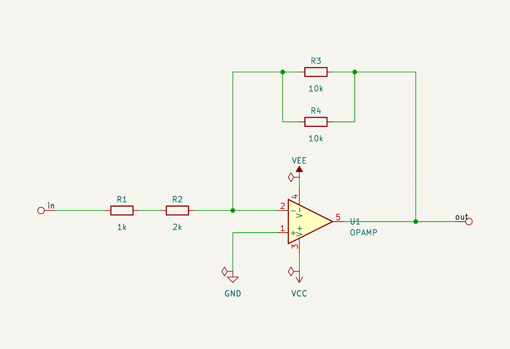
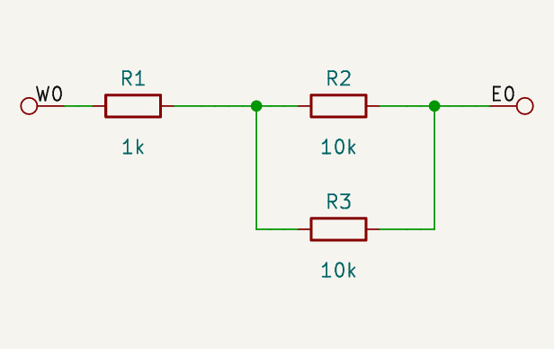
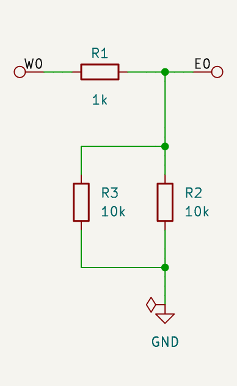
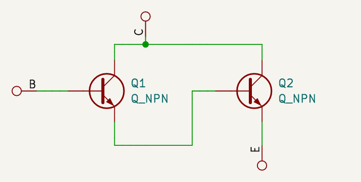
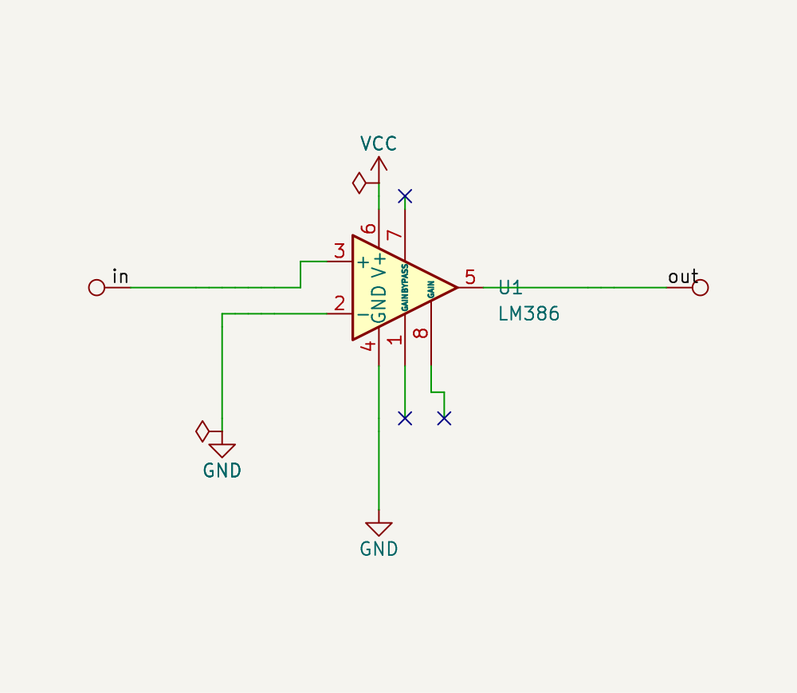
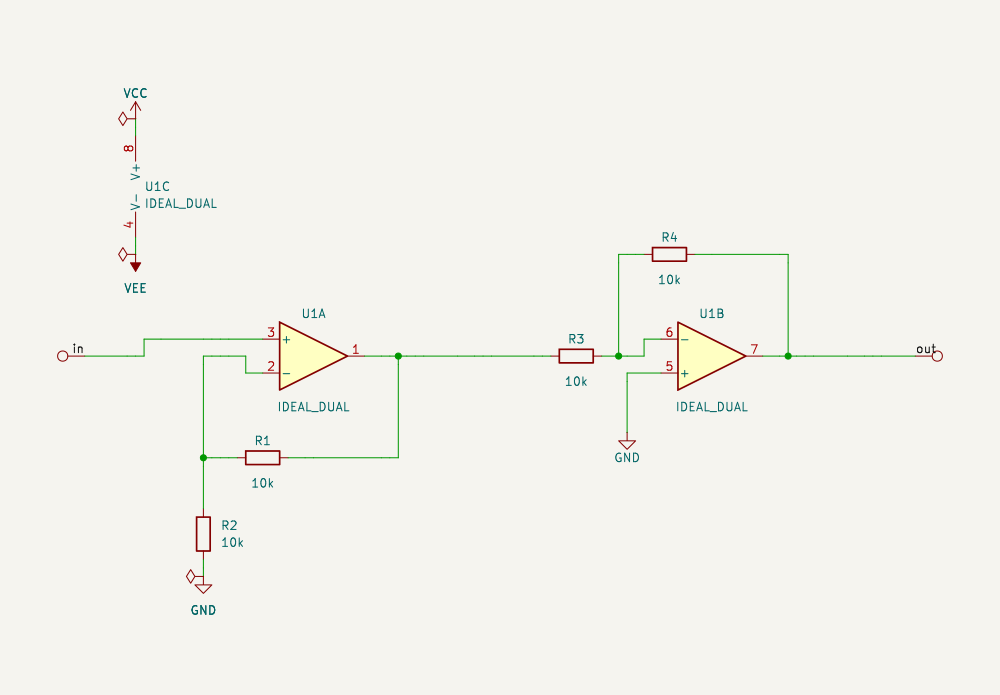
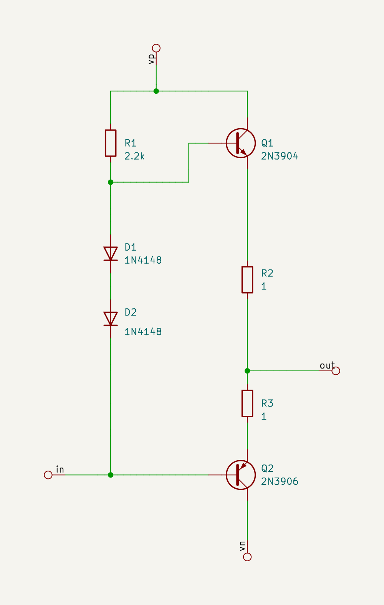

# yasdl — yet another schematic definition language

> *CLAUDE: Readable layout is a graph-drawing problem with subjective quality criteria. Decades of netlist-to-schematic work gave mediocre results, which discouraged text-to-schematic approaches in general. yasdl's insight is not to infer the 2D intent but to require it in the source, and to automate only the stretching and orientation.*

yasdl describes a circuit as **ASCII drawings of rectangular blocks** and turns them into a
**KiCad 9 schematic** and a **SPICE netlist**. The goal is a schematic that is readable by
construction.

The Python package requires Python 3.12+ and has no required third-party Python
packages. Standard components use KiCad symbol-library data; KiCad 9 provides
schematic export and validation, and ngspice provides simulation. SVG output can
be viewed directly. An SVG-to-PNG converter such as librsvg is optional.

- **2D, rectangular.** Each block is a small drawing: components are rectangles, wires are
  ASCII art. What you draw is the circuit's topology and its picture at the same time, so the
  output is planar and aligned without any automatic placement or routing.
- **Composition.** Blocks contain other blocks. A block fits a placeholder when its pins line up
  with the placeholder's wires: same count and order on each side, matching pin names. yasdl
  rotates or mirrors it automatically to make it fit. Large designs are built from small,
  separately readable blocks.
- **Layout.** Widths and heights are adjusted automatically by stretching wires. Symbols keep
  their size; nothing has to be positioned by hand.
- **Export.** KiCad schematics that pass ERC with no errors or warnings, and SPICE
  (sub)circuits for ngspice, both from the same object.

*(Netlist-first tools like [SKiDL](https://github.com/devbisme/skidl) compose circuits too, but
they treat a schematic as a graph and leave the drawing to an automatic placer and router.
That ignores the 2D nature of a schematic: medium to large designs can't be laid out
properly. yasdl keeps the 2D arrangement in the source.)*

## Example: an inverting amplifier in yasdl

```python
from yasdl import Block, C, OPAMP, R

SERIES = Block("Series", """
    ──R1──R2──
""", R1=R("1k"), R2=R("2k"))

PARALLEL = Block("Parallel", """
    ──┬──R1──┬──
      │      │
      └──R2──┘
""", R1=R("10k"), R2=R("10k"))

INV_AMP = Block("InvAmp", """
              ┌──────FB───────┐
              │               │
              │    [VEE]      │
              │      │        │
    {in}──IN──┴──────U1U1U1   │
                     U1U1U1───┴──{out}
              ┌─────+U1U1U1
              │      │
            [GND]  [VCC]
""", U1=OPAMP())

amp = INV_AMP.bind(IN=SERIES, FB=PARALLEL)   # sub-circuits plugged into the IN and FB holes
```



Full reference: [docs/SPEC.md](docs/SPEC.md).

## 1. Concepts

- **Block**: a rectangular canvas of characters. Its `W x H` cells are the text columns and
  rows. A block is a component that other blocks can use.
- **Component**: a rectangle of the canvas holding a name (`U1U1U1`, `NPN`, `FB`). Every
  component is **unbound** until a block binding gives it a value.
- **Binding**: `Block(name, canvas, U1=OPAMP(), ...)` or `.bind(...)`. A component can be
  bound to
  - an **atom**: a KiCad library symbol, rigid;
  - another **block**: a sub-circuit, stretchable.
- **Unbound components** are the block's open interface (the "holes"). They are bound later
  with `block.bind(...)`. A block can only be rendered or netlisted when everything is bound.
- **Ports**: the wires that leave the canvas edge are the block's external pins.

## 2. Canvas syntax

| Element | Looks like | Meaning |
|---|---|---|
| component | `R1`, or `U1U1U1` repeated over a rectangle | a placeholder; its name is the repeated word |
| wire | `─ │ ┌ ┐ └ ┘` (or `-` `\|`) | connections, drawn as ASCII art |
| junction | `├ ┤ ┬ ┴ ┼` | wires fork; `┼` always connects |
| crossing | `───│───` | wires cross without connecting (the middle character is on top) |
| net label | `[Signal]`, `[signal]`, `[VCC]` | uppercase initial = global; lowercase/underscore initial = block-local. Registered power names are global and draw as power symbols; leading digits are forbidden |
| port | `{in}`, `{out}` on the canvas edge | a named external pin of the block |
| pin label | `{b}`, `+`, `>`, `v` touching a component | which pin of the part this wire is; arrows also fix its orientation |

Empty cells are spaces (`.` is reserved for future use). Components must not touch each
other; keep at least one cell between them. Wires fork at tees and cross only where a
crossing is drawn. Buses (bundles of wires) are specified and will be supported later.

Prefer lowercase pin/interface names (`{input}`, `{b}`); uppercase names are still accepted.
Numeric names use braces (`{1}`, `{2}`). Outside a label, letters and digits form component
names: `─1U1─` names component `1U1`, with no implicit pin abbreviation.

Reading the inverting amplifier above:
- `IN` and `FB` are **holes**: unbound components with one wire on each side. Any 2-terminal
  part or sub-circuit fits; here the `SERIES` and `PARALLEL` blocks.
- `U1U1U1` (3 rows) is the op-amp. Its two inputs are on the left: the inverting input on top,
  joined to `IN` and `FB` by the `┴` junction. The `+` next to the lower input marks the
  non-inverting input; it tells yasdl to flip the op-amp symbol so `−` is on top.
- The output leaves on the right through the `┴` that also closes the feedback loop over `FB`.
- `[VEE]` above and `[VCC]` below are the supply pins; `[GND]` grounds the `+` input. They
  become KiCad power symbols, and `GND` is SPICE node 0.
- `{in}` and `{out}` are the block's ports.

## 3. Binding

A `Block` works like a C++ template: its canvas is a fixed arrangement of wires around
**placeholders**, and you fill the placeholders later, loosely, with whatever matches. The
ASCII drawing is wires plus holes. **Binding** inserts a component (a KiCad symbol) or a whole
sub-circuit (another block) into a hole, as long as its pins line up with the hole's wires. The
same template serves many circuits:

```python
gain10 = INV_AMP.bind(IN=R("10k"), FB=R("100k"))
integrator = INV_AMP.bind(IN=R("10k"), FB=C("10n"))
filtered = INV_AMP.bind(IN=SERIES, FB=PARALLEL)
```

## 4. Layout

To produce a presentable schematic, the block's wires are stretched automatically so that each
inner block or symbol gets enough room, and connected pins stay aligned. Everything is drawn on
a single KiCad sheet; hierarchical sheets will come later.

## 5. Export

- **KiCad 9**: a `.kicad_sch` (plus project files) and an SVG. Every export passes
  `kicad-cli sch erc` with no errors or warnings; the helpers ERC needs (power flags, test
  points on open ports) are added automatically. A round trip checks that KiCad reads back
  exactly the netlist yasdl generated.
- **SPICE**: `spice_netlist(block, subckt="name")` writes an ngspice (sub)circuit from the same
  design. Subcircuits declare `.global` for the supplies they use internally. For simulatable
  designs, KiCad 9's own SPICE export is checked against it: every element, its terminals,
  ground/global identity and its complete value, model, parameter or source text.
- Model libraries are copied into the project (`spice_models/`), so a generated project can
  move. `render(..., export_name="Variant")` names the files independently of the Block.

```python
from yasdl import spice_netlist
from yasdl.kicad_export import render

render(amp, "out")                                   # out/InvAmp.kicad_sch + .svg, with checks
print(spice_netlist(PARALLEL, subckt="parallel"))
```

Conventions worth knowing:
- **USE MEG FOR MEGA; USE lowercase m FOR MILLI** (`R("1MEG")`, `R("1m")`). KiCad and
  ngspice disagree about `1M`; direct SPICE generation rejects such values and rendering
  reports the mismatch. yasdl never rewrites values.
- Mirroring a five-pin op-amp moves its supply pins too. Label `{V+}`/`{V-}`, or use a
  three-port wrapper with the supplies wired inside (`std.powered`, `circuits.PoweredOpamp`).
- **NGSPICE EXIT CODE 0 DOES NOT GUARANTEE SUCCESSFUL ANALYSES OR MEASUREMENTS.** Check
  the log and every required measurement. Testbenches belong with the design.

Full callable interfaces and parameter conventions: [docs/API.md](docs/API.md).

### Parts, packages and standard blocks

```python
from yasdl import AtomNPN, Block, NC, Package, Pot, Q2N3904, R
from yasdl.circuits import NonInverting, SallenKey

q = AtomNPN("BD139", {"E": 1, "B": 3, "C": 2}, "models.lib")   # verify maps yourself
chip = Package("TL072", library="tl072_dual.lib", model_name="TL072_DUAL")
pre = NonInverting(opamp=chip.unit("A"))       # one chip, units in different blocks;
flt = SallenKey(opamp=chip.unit("B"))          # its power unit chip.unit("C") is bound once
unused = Block("Unused", "NC1─R1─{out}", NC1=NC(), R1=R("10k"))
```

- `yasdl.parts`: parts on KiCad's generic shapes with explicit pin maps and a separate SPICE
  terminal order (`AtomNPN`, `AtomPNP`, `AtomDiode`, `AtomOpamp3`, `AtomOpamp5`), verified
  standard parts (`Q2N3904`, `Q2N3906`, `BD139`, `BD140`, `D1N4148`, `transistor("2N3904")`)
  and multi-unit packages (`Package("TL072")`, `Package(dual_opamp("TL072", ...), "U1")`,
  `chip.unit("A")`, `chip.power()`): one reference, footprint and SPICE element per chip.
  Pin maps of new parts are yours to verify against the datasheet: round trips and
  simulation can't detect a wrong lead number.
- Two families of reusable blocks, all written as literal ASCII canvases: `yasdl.std`
  (construction functions and templates: powered op-amp wrapper, op-amp stages, RC and
  Sallen-Key filters, Darlington/Sziklai/parallel compound transistors, mirrors,
  differential pairs, class-AB push-pull stages driven at the string center or bottom) and
  `yasdl.circuits` with its positional shortcuts `yasdl.standard` (compound devices,
  push-pull output stages and self-biased followers, mirrors, sinks, differential pairs,
  filters, op-amp circuits).
- `NC()` no-connect markers, one per drawn wire end, without removing wires;
  `Atom(..., sim=False)` for connectors; `POT()`/`Pot()` potentiometers (pin 1 ccw, 2 wiper,
  3 cw) with linear and log tapers.

## 6. Skill

[skills/yasdl-circuit-design/SKILL.md](skills/yasdl-circuit-design/SKILL.md) teaches AI coding agents to design circuits in yasdl. It
covers hierarchical design (small blocks, composed by yasdl), the canvas cheat sheet, a style
guide and common errors.

## 7. Examples

| Example | Code | |
|---|---|---|
| Series, parallel, R + (R ∥ R) | [docs/examples/blocks.py](docs/examples/blocks.py) |  |
| PARALLEL bound into a vertical slot (turned automatically) | [docs/examples/blocks.py](docs/examples/blocks.py) |  |
| Darlington pair (fits wherever an NPN is drawn) | [docs/examples/blocks.py](docs/examples/blocks.py) |  |
| 2 kHz sine generator, composed from small blocks | [docs/examples/sgen.py](docs/examples/sgen.py) |  |
| LM386 with no-connect marker groups on unused pins | [docs/examples/blocks.py](docs/examples/blocks.py) |  |
| Dual op-amp package, units in two standard blocks | [docs/examples/blocks.py](docs/examples/blocks.py) |  |
| Class-AB push-pull stage from `yasdl.std` | [docs/examples/blocks.py](docs/examples/blocks.py) |  |
| Every reusable circuit of `yasdl.circuits`, NC markers, a shared package | [docs/examples/standard.py](docs/examples/standard.py) | `python -m docs.examples.standard out/standard` |

## 8. Tests

Run the full suite with Python 3.12 or later:

```sh
python3.12 -m pytest -q tests
```

Install KiCad 9 and its standard symbol libraries at a normal location, or set
`YASDL_KICAD` to its installation root. Put ngspice on `PATH`. Tests requiring missing
tools are skipped; a complete verification run has both tools available. Optional
test tooling belongs in a virtual environment; the library runtime uses only stdlib.
