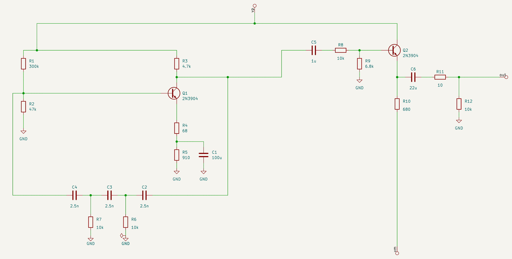

# yasdl specification

The full language and tool reference. For an overview and a first example, see
[README.md](../README.md).

## 1. Concepts

- **Block**: a rectangular canvas of characters. Its `W x H` cells are the text columns and
  rows. A block is a component that other blocks can use.
- **Component**: a rectangle of the canvas holding a name (`U1U1U1`, `NPN`, `FB`). Every
  component is **unbound** until a block binding gives it a value.
- **Binding**: `Block(name, canvas, U1=OPAMP(), ...)` or `.bind(...)`. A component can be
  bound to
  - an **atom**: a KiCad library symbol, rigid, can be rotated or mirrored;
  - another **block**: a sub-circuit, stretchable.
- **Unbound components** are the block's open interface (the "holes"). They are bound later
  with `block.bind(...)`. A block can only be rendered or netlisted when everything is bound.
- **Ports**: the wires that leave the canvas edge are the block's external pins.

## 2. Canvas syntax

### 2.1 Characters

| Class | Characters | Notes |
|---|---|---|
| empty | space | |
| reserved | `.` | reserved for future use; an error for now |
| component | `A-Z a-z 0-9 _` | see 2.2 |
| single wire | `─ -` `│ \|` `┌ ┐ └ ┘` `├ ┤ ┬ ┴` `┼` | ASCII `-` `\|` equal `─` `│` |
| bus | `═ ║ ╔ ╗ ╚ ╝`, taps `╟ ╢ ╤ ╧` | section 2.6 (specified, not implemented yet) |
| bracket label | `[text]` on one row | global or local net name (2.4) |
| arrows | `<` `>` `^`, and a lone `v`/`V` | reserved for directional pin labels (2.5) |
| brace label | `{text}` on one row | adjacent component pin (2.5), otherwise an interface on the block edge (2.7) |
| pin shortcut | `+` | a one-character pin label |

Any other character is an error. Whatever isn't explicitly allowed below is forbidden.

### 2.2 Components

- A component is a **rectangle of component characters** whose rows are all the same
  string.
- Its name is that string's **minimal period**, computed with the KMP failure function:
  `U1U1U1` → `U1`, `RRRR` → `R`. If no period divides the string evenly, the whole string is
  the name: `NPN` → `NPN`, `U1U1U` → `U1U1U`.
- Names are **local to the block**: `U1` in two blocks are two components.
- A component can't be named `v` or `V` (or `vv`, `VVV`, which reduce to it): a lone `v` is the
  down-arrow pin label (2.5). `v` inside a longer name is fine (`v1v1v1` → `v1`, `VR1`).
- **Gap rule**: components never touch. Touching characters merge into one rectangle, or fail
  if the result isn't one. Keep at least one empty or wire cell between components. The gap
  is also where the layout puts its wire adapters (section 4).
- A component's on-canvas size says nothing about its real size; binding decides that, and
  the layout stretches around it.

### 2.3 Single wires

- Every wire character has **arms** toward its neighbours: `─` has E and W, `┬` has E, S
  and W, `┼` has all four. Each arm must meet one of:
  - a wire that continues it;
  - a label;
  - a component edge (making a pin attachment);
  - the canvas edge (making a port).

  An arm pointing at an empty cell is a **dangling wire**, an error.
- `┼` is always a **junction**. Tees `├ ┤ ┬ ┴` are the only other junctions, and they get a
  dot in KiCad.
- **Crossing** (no connection): a straight wire with perpendicular wires arriving on both
  sides. The character drawn is the wire on top; the other passes under.
  ```
     │              │
  ───│───   or   ───────     (vertical on top / horizontal on top)
     │              │
  ```
- A crossing may sit directly beside a component or label. The renderer connects through
  it to the next real node or pin, without placing an electrical endpoint on the crossing.
- A wire that ends on a straight wire from one side only (an implied T) is an error; use a
  tee.

### 2.4 Bracket labels: nets

Square brackets always name nets. A net label needs at least one wire and must not directly
touch a component; insert a wire between a net label and a component. Use braces to name a
component pin (2.5).

| Name | Meaning |
|---|---|
| starts with `A-Z`, e.g. `[Signal]` | **global net**: the same name connects across every block and instance |
| starts with `a-z` or `_`, e.g. `[signal]`, `[_bias]` | **local net**: the same name connects within this block only |
| registered power name, e.g. `[+5V]`, `[-12V]` | **global net**, regardless of its initial character |
| starts with a digit, e.g. `[1]`, `[0]` | error; numeric names are permitted for brace pins/interfaces, not nets |

Scope depends on the name, not the number of wires. `──[Signal]──` is global, and a terminal
`──[signal]` is local. Every net label needs at least one wire. Registered power names must
still use their exact registered spelling (`[GND]`, not `[gnd]`).

Horizontal wires enter at the opening `[` or closing `]`. Vertical wires may enter at any
column occupied by the label, including either delimiter; two vertical wires through one
label must use the same column.

- **Power nets**: a global label whose name is in the power-net registry (`GND`, `GNDA`, `VCC`,
  `VEE`, `VDD`, `VSS`, `+5V`, `+3V3`, `+12V`, `-12V`; extend with
  `register_power_net("+15V", "power:+15V")`) is drawn as that KiCad power symbol. The symbol's
  pin faces the wire and its body points away; the layout reserves its real size. Electrically
  nothing changes: the net is still the global net, and `GND` is SPICE node 0. So
  ```
     │
   [GND]
  ```
  replaces placing `GND()` atoms one by one.
- In the flat KiCad output, local names are prefixed with the instance path (`FB.x`); global
  names are not.

### 2.5 Pins

Migration: replace old component pin labels such as `[b]` and `PS[in]` with `{b}` and
`PS{in}`. Square-bracket net labels such as `[GND]` keep their meaning.

- A pin **attachment** is a wire arm, a brace label, or a shortcut touching a component edge.
- Pins on a side are ordered: **W and E sides top to bottom, N and S sides left to right**.
- **Brace pin labels**: `{name}` adjacent to exactly one component edge names its pin. For
  atoms, it matches a KiCad pin name or number, case-insensitively; for sub-blocks, one of the
  port names or aliases (2.7). `{b}` and `{e}` on an NPN fix its base/emitter connections;
  `{1}` may identify a numbered pin. The label needs exactly one wire on the side opposite
  the component. It is an orientation constraint and never names a net.
- **Adjacency decides usage**, even at the canvas edge. A brace touching a component is a
  pin label; a brace touching no component is an interface declaration and must obey 2.7.
  These meanings do not depend on the spelling or case of the name.
- **Horizontal adjacency**: the opening `{` or closing `}` must immediately touch the
  component. The wire enters through the other delimiter.
- **Vertical adjacency**: any character of the brace label, including `{` and `}`, may be
  directly above or below the component. Any column of the label, including either brace,
  may carry the vertical wire. The wire column need not overlap the component: the label
  connects its wire to the nearest column shared by the label and the component. All wire
  segments remain orthogonal when laid out.
  ```
  {input}────{b}Q1Q1      the wire ends on Q1's base; {input} names the block interface (2.7)
                Q1Q1
  ```

Both vertical layouts are valid:

```
Q1Q1Q1          Q1
 {e}             {e}
  │                │
```

In the second layout, `{` touches the component and the wire enters through `}`. Above a
component the same rule applies. A label touching two components or two sides of one
component is an error, including `Q1{b}Q2` and:

```
Q1 Q2
 {e}
```

A brace after a wire bend is an interface if it does not touch the component:

```
   [VCC]
      │
     {c}
{b}─Q1
     └{e}
```

Here `{c}` names Q1's collector; `{b}` and `{e}` declare W0 and E0 interfaces. Removing the
bend leaves `{e}` with neither component adjacency nor a wire, which is an error. Pin labels
may contain a KiCad pin's literal name (for example `{-}`); comma-separated aliases are
interface declarations, not a list of component pins.

  ```
   │
  {c}
  Q1Q1          collector on top, base on the right: the NPN is mirrored
  Q1Q1{b}─
  Q1Q1
   │
  ```

- `+` is a one-character pin label (`──+C1──`, or `+` on the op-amp's non-inverting input
  above). Atoms can declare aliases, e.g. `C_POL` maps `+` to pin 1.

#### Directional pin labels: `<` `>` `^` `v`

The arrows are one-character pin labels that **rotate and mirror with the part**. `v` and
`V` are the same arrow; a `v` is an arrow only when no letter, digit or `_` touches it left or
right (`v1v1v1` is a component named `v1`), which is why no component may be named `v`.

- **Meaning: conventional current.** An arrow at a pin points the way current flows through
  that pin: into the part on an input, out on an output. Atoms declare arrows in their library
  orientation (`Atom(..., arrows={pin: arrow})`):
  - `D`: the anode, `<` (current enters it and points at the cathode);
  - `NPN`: base `>` (in), emitter `v` (out, like the symbol's own arrow);
  - `PNP`: base `<` (out), emitter `^` (in).
- **One pin per arrow.** On atoms and on block ports alike, an arrow names exactly one pin, so
  `{>}──…──{>}` is an error (two ports with one alias). Name other pins with braces (`{c}`).
- **Placement**: `<` and `>` only beside a component (W/E sides), `^` and `v` only above or below
  it (N/S). An arrow touching nothing, or on the wrong axis, is an error. This also keeps arrows
  from merging into names: `──vQ1` would be a component `vQ1`, and the error says so.
- **Matching**: when binding, an arrow label at a side fits a pin only if that pin's arrow,
  turned by the candidate orientation, points the same way (3.2). So arrows choose the
  orientation. Each drawing below is a separate example:
  ```
  ──>D1──        diode, anode on the left

  ──D1<──        diode, anode on the right (library orientation)

     │
     v           diode, anode on top
     D1
     │

  ──<Q2Q2──      NPN in common base: emitter current leaves on the left, base current
     Q2Q2        enters from below, collector on the right (no arrow)
     Q2Q2
     ^
     │
  ```
  Arrows that no orientation can produce are rejected. `──D1>──`: only the anode has an
  arrow, and it points into the part. `──>Q2Q2>──` is invalid for a more basic reason: two `>`
  would name two pins, and one arrow names one pin.
- **Block ports** take arrow aliases from `{<}`, `{>}`, `{^}`, `{v}`: `<`/`>` only on W/E ports,
  `^`/`v` only on N/S ports, so a rotation can never turn an arrow into a letter glued to a name.
  An arrow alias is never a port's display name.

**Mirror-agnostic pairs.** Arrows on opposite ports that point the same way relative to the
block (both outward `{<}──…──{>}`, or both inward `{>}──…──{<}`) still match after a
left/right mirror. Such a block fits either way round, with **no guarantee which port lands on
which side**:
```
TWO_R = Block("TwoR", "{<}──R1──R2──{>}", R1=R("1k"), R2=R("2k"))
Block("H", "{a}──<RX>──{b}", RX=TWO_R)                # a–R1 … R2–b
Block("H", "{a}──<RX>──{b}", RX=TWO_R.mirrored("y"))  # a–R2 … R1–b: the same labels fit
```
That's fine for parts that don't care (a resistor network, a fuse). When direction matters, give
the block one arrow (`{>}──D1──{k}`: `──>DX──` fits only one way) or name the ports
(`{a}`/`{k}` labels in the host). Arrows are optional: `──R1──` needs none.

### 2.6 Buses (specified, not implemented)

- `═ ║` with elbows `╔ ╗ ╚ ╝` carry an **ordered, parallel bundle** of 1 or more wires. A
  single wire may be drawn as a bus.
- **Order is travel-relative and invariant.** Walking along a bus, its wires are ordered
  from the walker's left to right; elbows don't change that. At a component side, this
  becomes the side's pin order (2.5): a bus leaving an E side heading east has its first
  wire at the top. So `U1.E[i]` connects to `U3.W[j]` by position, and the drawing alone
  defines the mapping. Mirroring a component reverses its side order, and so changes the
  netlist; there are no implicit crossing adapters.
- **Width inference**: a component side's pin list is the concatenation of the buses and
  wires attached to it, in order. Widths propagate from bound components. When every bus on
  a side but one is known, the last one is inferred. An undetermined width is an error.
- **Taps**: only single-wire taps, `╟ ╢ ╤ ╧`, each followed by a label that selects the wire
  by name or 1-based number (`╟──[3]──`, `╟──[MISO]──`). Tapping a wire the bus doesn't carry
  is an error. Taps take wires out of a bus; they never add them.
- **Crossings**: at 90° only, never connecting, drawn like single-wire crossings (2.3), with
  the character on top shown in the middle. Allowed pairs: bus/bus and single wire/bus
  (either on top):
  ```
    ║            │
  ──║──   or   ═════      (bus over wire / wire over bus)
    ║            │
  ```
  There is no bus-to-bus junction (`╬`) or bus tee (`╠`). Other junctions and shapes are
  forbidden.
- **Ports**: buses reaching the canvas edge are ports. Their wires appear in the side's pin
  list in order, named by the bus's net labels (`[a]═══` gives `a.pins`).
- **KiCad**: drawn as individual parallel wires. (Open: use KiCad buses above some width.)

### 2.7 Ports (block interface)

- **Where**: a wire arm leaving the canvas, or a **brace label** `{name}` on the canvas edge.
  A brace label may list several aliases, comma-separated: `{c, collector}`,
  `{+, non_inv, noninverting, plus}`, `{>, A, Anode}`, `{<,>}`. Spaces around commas are
  ignored. The first alias that is a name (not `+` or an arrow) is the port's display name.
  The brace label has exactly one wire, going inward, and sits on the side opposite that wire
  (`{in}───` on the W edge, `───{out}` on the E edge, top/bottom rows for vertical wires).
  A brace touching a component is a pin label (2.5); an interface declaration anywhere
  else in the interior is an error.
- A component sitting on the canvas edge exports nothing. Ports must be drawn as wires.
- **Order and default names**: per side, ordered as in 2.5, named `W0`, `W1`, `N0`, ...
- **DIP number**: each port also gets a unique number `D0`, `D1`, ..., counting
  counterclockwise from the top of the W side: W top to bottom, S left to right, E bottom to
  top, N right to left (like the pins of a DIP package).
- **Aliases**, in priority order:
  1. the port's `{name}` label;
  2. programmatic aliases (below);
  3. **re-export**: if the port has neither, and its net reaches exactly one distinct pin name
     (an atom pin name other than `~`, or a sub-block port name), that name becomes the alias.
     The Darlington's ports become `B`, `C` and `E` this way, and a host can orient it with
     `{b}`/`{c}` labels. A re-exported name that collides with another port's name, or looks
     like a default name, is silently dropped.
- **Names**: aliases are letters, digits and `_`, or one of the shortcuts `+ < > ^ v`.
  No `-` or spaces (SPICE node names can't carry them). Net names additionally require the
  initial scope character from 2.4, except registered power nets (`-12V`, `+5V`). Pin labels
  stay free-form, because they match KiCad pin names such as the op-amp's `-`.
- **Uniqueness**: no two ports may share an alias (case-insensitive), within one `{}` list or
  across ports. `{<,>}──…──{>}` is an error. Aliases may not look like
  default names (`W0`, `D3`, ...) or use a reserved global name (`GND`, `VCC`, `0`, ...; 2.8).
  All are errors, whether from the drawing or from code.
- **Programmatic attributes**: `Block(name, canvas, port_attrs={key: {"aliases": [...]}}, ...)`.
  A key is a default name (`W0`), a DIP number (`D2`) or an existing alias. Only `aliases` is
  supported for now; direction and class (`in`, `out`, `inout`, `pwr`) are planned. Unknown
  keys and attributes are errors.
- `block.port(key)` looks a port up by any of its names.

### 2.8 Net naming

One rule: **every net name in a design is unambiguous, everywhere it ends up** (yasdl's
netlist, KiCad, SPICE). KiCad matches names case-sensitively and ngspice ignores case, so names
are compared case-insensitively.

Net names start with an uppercase ASCII letter for global scope, or a lowercase ASCII letter
or `_` for local scope (2.4). Registered power names are exceptions. Names may contain letters,
digits and `_` after the first character; leading digits are forbidden. Scope is distinct
from uniqueness: different nets may not differ only in case, because SPICE treats those names
as identical. For example, choose `[GlobalSig]` and `[local_sig]` rather than `[Sig]` and `[sig]`
for two different nets in one block.

1. **User-given names** (global labels, port aliases, local labels) must be unique across the
   design. Two different nets with one name are an error, never silently merged. That includes
   a top-level port alias equal to a global net used inside a sub-block.
2. **Global net names are reserved**: the power-net registry (`GND`, `VCC`, `VEE`, ...; 2.4) and
   `0`. Global nets are design-wide, and a block can't know which parents will use it, so these
   names are taken in every block:
   - no port alias (`{GND}`, `{0}`, `{vcc}`, or `port_attrs`) may use them;
   - labels must spell them exactly as registered (`[GND]`, not `[gnd]`); `[0]` is never
     allowed;
   - a label with a reserved name is always the global net, even inline (`──[GND]──`);
   - pin names like `GND` are never re-exported as port aliases.
3. Labels may not look like default port names (`W0`, `N1`, `D3`), and a block's labels may not
   reuse its port aliases.
4. **Derived names** (default port names `W0`, ...) get a `_2` suffix if they'd clash;
   **generated names** (`N1`, `N2`, ... for unnamed nets) skip every name already taken.
5. **SPICE**: the global `GND` net is node `0`. Every other net keeps its name, sanitised and kept
   unique ignoring case. A port wired to ground can't be a `.subckt` pin (SPICE ground is
   global), so `spice_netlist(subckt=...)` rejects it.

## 3. Binding

### 3.1 Signature

A component can only be bound to something with **exactly the drawn number of pins on each
side**:
- an atom whose symbol has a pin where the drawing has none can't be bound;
- a block whose W side has two ports can't go into a component drawn with one W wire;
- a 3-port Darlington fits anywhere an NPN is drawn, because both have one pin on the top,
  left and bottom.

Pins map to attachments **by position along each side**.

### 3.2 Orientation

Orientation is decided **only at binding**. A canvas never rotates anything it contains; a
component is always drawn as it is. The same rules apply to atoms and sub-blocks. The 8
candidate orientations are rotations by 0/90/180/270° counterclockwise, each with or without a
top/bottom mirror (`"y"` is accepted and equals `"x"` plus 180°).

1. **Explicit**: `R().rotated(90)`, `PARALLEL.rotated(270)`, `OPAMP().mirrored("x")`,
   `LADDER.mirrored("y")`. These compose: `.rotated(90).mirrored("y")`. The low-level form is
   `.oriented(rot, mirror)`. The result must fit the drawing, or binding fails.
   `"y"` mirrors left/right and `"x"` top/bottom, as in KiCad. Internally `"y"` is stored as
   180° plus `"x"`; the JSON view shows it as `"y"`.
2. **Pin labels** (2.5): only orientations consistent with every label stay candidates. With
   an explicit orientation, labels are checked against it and a contradiction is an error, so
   a label is also a cheap assertion that documents the intent on the drawing. For
   atoms, labels match pin names or numbers; for sub-blocks, port names. If several
   remain, rule 3 chooses among them.
3. **Forced by the drawing**: the candidate must have exactly the drawn number of pins on
   every side (3.1). Among the candidates that fit:
   1. the one that best **keeps reading order** wins: pins on a start side (N, W) stay on a
      start side, pins on an end side (S, E) stay on an end side;
   2. then the one that **flips fewer axes**: a mirror flips one axis, a 180° turn or a
      quarter turn changes both. A sub-block's insides keep their up/down (or left/right)
      when only the other axis must change;
   3. then the order above (unrotated first).
   - The unrotated orientation always keeps reading order, so it wins whenever it fits.
   - A resistor (library: vertical) between W and E wires lies down with pin 1 on the left.
   - The horizontal PARALLEL block in a vertical slot turns so that its left port is on top
     (example `SHUNT`). `PARALLEL.oriented(90)` puts it at the bottom.

Inconsistent labels, like `{e}` where only C or B could go, are errors. When the electrical
direction matters but nothing in the drawing pins it down, e.g. a non-symmetric 2-port in a
vertical slot, rule 3 still decides, deterministically. Label a pin or orient explicitly if
the default isn't what you want.

*(Corner markers like `*` for pin 1 were considered and dropped: they break the KMP naming.
Pin labels give the same information.)*

### 3.3 Sub-blocks

A bound sub-block is oriented exactly like an atom (3.2). Its ports then map, per side and in
drawing order, to the component's attachments. In the layout, the sub-block's finished drawing
is rotated or mirrored as a whole, and the orientations of the symbols inside it are composed
with the block's.

## 4. Layout

- **Grid-bag.** Every canvas row r gets a centreline `y[r]`, every column c a centreline
  `x[c]`, every component an origin. Rows and columns stretch to their contents, and
  stretching propagates through nested blocks: a bound sub-block is laid out first, then
  placed as a rigid shape.
- **Only wires stretch.** KiCad symbols are rigid. They can be rotated or mirrored but not
  scaled. Horizontal wires stretch along X, vertical wires along Y.
- **X and Y are independent** systems of difference constraints, solved by longest path
  (Bellman-Ford):
  - rows and columns are strictly ordered;
  - consecutive items in a column (for Y) or row (for X) keep a clearance;
  - a component's first pin on a side lies exactly on its wire's line; further pins are
    aligned greedily while that stays feasible.
- **Ladder adapters.** A pin that can't be aligned is reached by a jog in the gap next to the
  component, one track per jogging pin. The tracks are ordered so that no two wires cross
  (river routing). Each jog widens the component's extent by one track (2.54 mm) on that side.
  X and Y iterate until the set of jogs stops changing.
  ```
      |                  |            | |          (pins 1-4 shifted individually,
      └-┐                |            | |           order preserved, no crossings)
        | ┌--------------┘            | |
        | | ┌-------------------------┘ |
        | | | ┌-------------------------┘
        | | | |
  +-----1-2-3-4------+
  ```
- **Spilling shapes.** A bound shape is usually much larger than its few canvas characters.
  It can reach under items in other rows and columns. Boxes (components with their text, and
  net labels) that overlap are separated pairwise: in Y if their canvas rows are disjoint,
  otherwise in X. The overlap test uses the other axis's current solution, and these
  separations join the X/Y iteration.
- **Text space**: reference and value fields are reserved in each atom's extent.
- **Grid**: every coordinate is a multiple of 1.27 mm (KiCad's default grid).

## 5. Internal representation

There are three layers, each derived from the one before:

| Layer | What it holds | Where |
|---|---|---|
| Source | canvas text + bindings | `Block(name, canvas, **bindings)` |
| Resolved block | components with rectangles, attachments and resolved bindings (orientation, pin↔wire map); local nets; ports | `Block.canvas`, `Block.bound`, `Block.to_dict()` |
| Layout | coordinates: symbols with orientation, wire segments, labels, ports, bbox | `layout.Result` |

`Block.to_dict()` exports the resolved block as JSON. Sub-block definitions are listed once
under `"blocks"` and referenced by name. Excerpt for `INV_AMP_RESISTORS`:

```json
{
  "name": "InvAmp",
  "size": {"cols": 25, "rows": 9},
  "canvas": ["      ┌──────FB───────┐", "...", "     GND   [VCC]"],
  "components": {
    "U1": {
      "rect": {"row": 4, "col": 13, "rows": 3, "cols": 6},
      "binding": {"atom": "Simulation_SPICE:OPAMP", "value": "", "rot": 0, "mirror": "x"},
      "attachments": {
        "N": [{"pos": 13, "net": "VEE", "pin": "4"}],
        "E": [{"pos": 5, "net": "E0", "pin": "5"}],
        "S": [{"pos": 13, "net": "VCC", "pin": "3"}],
        "W": [{"pos": 4, "net": "N1", "pin": "2"},
              {"pos": 6, "net": "GND", "label": "+", "pin": "1"}]
      }
    },
    "FB": {
      "rect": {"row": 0, "col": 13, "rows": 1, "cols": 2},
      "binding": {"block": "Parallel", "rot": 0, "mirror": null},
      "attachments": {"E": [{"pos": 0, "net": "E0", "pin": "E0"}],
                      "W": [{"pos": 0, "net": "N1", "pin": "W0"}]}
    }
  },
  "unbound": [],
  "ports": [{"side": "E", "index": 0, "dip": 1, "aliases": [], "net": "E0"},
            {"side": "W", "index": 0, "dip": 0, "aliases": [], "net": "W0"}],
  "nets": {
    "N1":  {"pins": ["FB.W0", "IN.E0", "U1.2"], "ports": [], "labels": []},
    "VEE": {"pins": ["U1.4"], "ports": [], "labels": [{"text": "VEE", "row": 2, "col": 11}]}
  },
  "blocks": {"Series": {"...": "..."}, "Parallel": {"...": "..."}}
}
```

- `pos` is the canvas row (W/E) or column (N/S) where the wire meets the component.
- `pin` is the atom's pin number or the sub-block's port name (its first alias, else its
  default name).
- Nets are **local**: sub-blocks are opaque, and their ports appear as `FB.W0`.
  `yasdl.netlist()` gives the flattened view.
- The source layer alone is enough to rebuild everything; the rest is a parsed view, for
  tools and debugging. (Open: should JSON be an input format too?)

## 6. Export

### 6.1 KiCad output

- One flat sheet on the smallest landscape ISO page from A4 through A0 that contains the
  complete drawing and port-label margin. Symbols are copied from KiCad 9's libraries into
  `lib_symbols`. References are annotated (`R1`, `Q2`, `#PWR001`), and each symbol carries a
  `yasdl_path` field with its hierarchical name (`FB.R1`).
- `to_kicad(..., references="names")` (also `render`) uses each component's yasdl name as its
  reference (`RI`, `Rint1`) instead of annotating `R1`, `R2`; when names repeat across
  sub-blocks it uses the flattened path (`A_RI`). `values=False` hides value fields (they stay
  in the file and the SPICE export), for symbolic drawings.
- Wires, junction dots, net labels, and labels for the top block's ports. Ports that alias an
  existing net name (e.g. `{VP}` connected to `[VCC]`, or two ports on one wire) retain their
  visible names as non-electrical text. Only the canonical name becomes an electrical label,
  avoiding KiCad's `multiple_net_names` warning without hiding or disabling ERC checks.
- **ERC-clean by construction.** Every exported schematic passes `kicad-cli sch erc` with no
  errors and no warnings. Nothing is required in the drawing; the export adds:
  - a `.kicad_pro` and a `sym-lib-table` next to the schematic, so the symbol libraries are
    found;
  - a **test point** (`Connector:TestPoint`, hidden fields, excluded from BOM and
    simulation) at each open port of the top block, so an interface net isn't a
    "label on a single pin";
  - a **power flag** (`power:PWR_FLAG`, hidden) on every net that has power-input pins but no
    power output, e.g. GND, VCC, VEE. It goes on a power symbol, else a global label, else a
    power pin, turned across the wire. Nets for this are rebuilt from the geometry, as KiCad
    does.

  `to_kicad(..., erc_helpers=False)` leaves them out. Helpers never appear in the round-trip
  comparison or in SPICE output.
- **Round-trip check.** `kicad-cli sch export netlist` on the generated file must reproduce
  `yasdl.netlist()` exactly, compared as sets of pins per net with power symbols excluded. A
  rendering only counts if it passes.
- `kicad-cli sch export svg`, cropped to the drawing.

Set `YASDL_KICAD` to a KiCad installation root. Prefix installations use
`bin/kicad-cli` and `share/kicad`; macOS installations may point at either the directory
containing `KiCad.app` (for example `/Applications/KiCad`) or the app bundle itself.

### 6.2 SPICE export

`spice_netlist(block, subckt="name", port_order=None, includes=())` writes an ngspice netlist
from the flattened design:
- **Ports**: with `subckt`, the netlist is wrapped in `.subckt name <ports>`, ports in DIP
  order (2.7) unless `port_order` lists port names. Formal port aliases take precedence over
  internal global names in subcircuit exports: `{VP}` wired to `[VCC]` yields a `VP` pin and
  `VP` device nodes. Without `subckt`, a flat netlist is written and retains `VCC`.
  Ground remains implicit node `0`, never a subcircuit port. Two ports on one net can't both
  be subcircuit pins (ngspice silently miswires duplicate formal nodes), so that's an error.
- **Nodes**: global nets keep their names, and `GND` becomes node `0`. Ports use their
  aliases; other nets are `n1`, `n2`, ...
- **Elements**: each atom becomes one element named `<letter>_<path>` (`C_PS_C1`), through a
  `SpiceModel(prefix, pins, model, sim_pins)`. Defaults exist for `Device:R/C/L/D/Q_NPN/Q_PNP`.
  Model-based parts take the model name from the value (`NPN("2N3904")`). Other symbols
  need `Atom(..., spice=SpiceModel(...))`, or export fails with an error. Power symbols are
  global nets, not elements.
- **Bundled library** `yasdl` (`yasdl/lib/yasdl.kicad_sym`, models in `yasdl/lib/yasdl.lib`)
  holds symbols KiCad lacks. `OPAMP_IDEAL()` is `yasdl:OPAMP_IDEAL`: the op-amp triangle with
  only `+` (pin 1, above), `-` (pin 2) and the output (pin 3), no supply pins, so it needs no
  rail wires. It simulates as `yasdl_ideal_opamp`, a behavioural source
  `V(out) = 1e9 * (V(+) - V(-))`. A `SpiceModel` may name its `library`; `spice_netlist`
  `.include`s each such library once, and the KiCad export puts it in `Sim.Library`. The
  generated `sym-lib-table` lists the bundled libraries next to KiCad's, and is rewritten when
  the set of libraries changes.
- **Sources**: `V(spec)` (`Simulation_SPICE:VDC`, `+` on pin 1, on top) and `I(spec)`
  (`Simulation_SPICE:IDC`) export as `V`/`I` elements whose value is the SPICE source
  specification (`"dc 0 ac 1"`, `"pulse(...)"`). SPICE current flows from pin 1 through the
  source to pin 2, i.e. out of pin 2, which carries the arrow `v`.
- **KiCad simulation fields**: `to_kicad(..., spice_libs=(paths,))` adds `Sim.Library`,
  `Sim.Name` and `Sim.Pins` to model-based parts whose model is defined in one of the libraries.
  `kicad-cli sch export netlist --format spice` then works on the schematic. ERC helpers are
  excluded from simulation.
- **SPICE round trip**: `render(..., spice=True)` checks that KiCad's SPICE export of the
  schematic equals yasdl's own netlist, element by element.

`yasdl/lib/jellybean.lib` bundles reusable 2N3904, 2N3906 and 1N4148 SPICE models;
`yasdl.kicad_lib.JELLYBEAN_MODEL` gives its path. The sine-generator example uses this library
for simulation. `tests/test_sine_generator.py` compares the generated netlist against
`tests/test_sine_generator.lib` and simulates both netlists. These fixtures are checked in;
the tests skip only when KiCad or ngspice is unavailable.

**Example: `docs/examples/sgen.py`**, a 2 kHz RC phase-shift oscillator plus
emitter-follower buffer, composed from small blocks:
- `PHASE_SHIFT`: the 3-section RC ladder;
- `OSCILLATOR`: the Q1 gain stage with the ladder as feedback;
- `OUTPUT_AMP`: from the coupling capacitor CK on, the Q2 emitter follower and AC-coupled
  output;
- `SGEN`: a 7-line top level wiring OSC → AMP, with the `{vp}` supply on top and `{vm}` at the
  bottom. The supply/output pin order (V+, V−, OUT) is given as `port_order=SGEN_PINS`.

Each canvas is small and stands alone (each renders ERC-clean); yasdl composes the final
planar schematic. Grounds are `[GND]` labels. The ladder's input is declared `{in, >}` and
drawn as `PS<` in the oscillator: the arrow puts its input on the right. Of the two fits (180°,
left/right mirror), the mirror flips fewer axes (3.2), so the shunt legs keep hanging down.
Both transistors label `{b}` and `{e}` explicitly, fixing their base/emitter connections
and preventing a top/bottom mirror from swapping collector and emitter.
The generated `.subckt sgen vp vm out` is structurally identical to the fixed test netlist.
In ngspice, both the yasdl netlist and KiCad's export of the generated schematic oscillate
at about 1967 Hz, matching the test circuit.



## 7. Tooling

- The KiCad S-expression reader (`yasdl.sexp.parse`) raises `ValueError` with an
  unexpected-end message for empty input or an unterminated list, quoted string,
  or escape.
- `Sketch`: build wide canvases by coordinates (`text`, `hline`, `vline`, `box`, `render`)
  instead of typing them by hand.
- **Agent skill** `skills/yasdl-circuit-design/SKILL.md`: the workflow, canvas cheat sheet,
  layout style guide and error fixes for EE-assistant agents.

## 8. Status

| Part | State |
|---|---|
| Canvas: components, KMP names, wires, crossings, labels, pin labels, `+`, ports | done |
| Binding: signatures, orientation rules (atoms and sub-blocks), flat netlist, JSON view | done |
| Grid-bag layout with greedy alignment and ladder adapters | done |
| KiCad 9 export, round-trip check, SVG | done |
| ERC-clean export (project files, test points, power flags), ERC in tests | done |
| Buses | specified, not implemented |
| SPICE export (subckt, DIP port order), KiCad Sim fields, SPICE round trip | done |
| Hierarchical sheets | not started |

## 9. Open questions

- Bus crossings: should "which bus is on top" carry meaning (like PCB layers), or is it
  only how it's drawn?
- KiCad buses vs parallel wires: switch above some width (5?).
- Global pin numbering for block ports, e.g. DIP-style counterclockwise from top-left, in
  addition to side/index.
- How binding-time orientation of a sub-block interacts with bus order (2.6). Reversal is
  the expected consequence; confirm when buses are implemented.
- Flat output vs one hierarchical KiCad sheet per sub-block.
- Label text width is estimated (1.27 mm per character), not measured.
- Component names with a repeating period collapse by design (`CC` → `C`, `RR` → `R`). That's
  surprising in practice; a warning when a multi-character row reduces to one character
  might help.
- SPICE for op-amps with supplies (`OPAMP()`): still needs a user `SpiceModel`; `OPAMP_IDEAL()`
  covers the ideal case.
